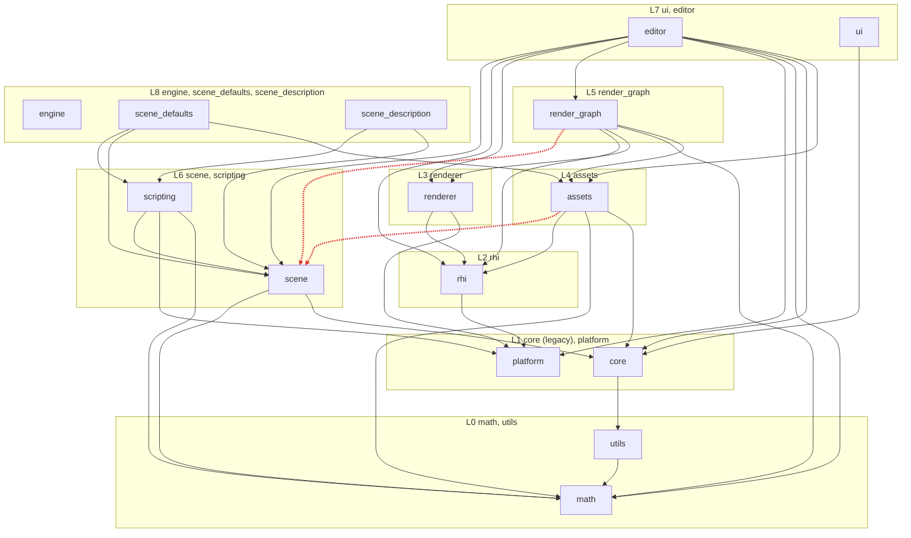

# Audit map

Phase 1 of the foundation audit. Facts only; findings come in the `findings-*.md` files. The
per-group map parts (`map/*.md`) that this summary was built from were removed after the audit;
references to them in the findings files point at that removed detail.

Baseline (audit build, Clang debug, SDK 1.4.328.1, since deleted): 559 build steps, no warnings;
`ctest` 112/112 pass (rhi 71, render_graph 22, assets 11, math 5, device 3).

## One-page overview

**Shape.** About 17k lines of C++ outside `ai/`. Two halves:

- **Render stack (new style, ~11k lines).** `platform` ← `rhi` ← `renderer` ← `render_graph`, with
  `assets` on `rhi`. Desc structs, `create() -> std::expected`, bindless with fixed slots, buffer
  device address, one shared pipeline layout, generational handles. `rhi.cppm` re-exports 23 of
  26 partitions; `aegis.rhi` is imported by 56 files. `Device` is the hub (20+ create/free
  overloads). No threads anywhere; all GPU work goes to the graphics queue; `computeQueue()` and
  `transferQueue()` exist but have no callers. `render_graph` is a single module and target that
  holds the framework (`FrameGraph`, `schedule`, `ResourcePool`, `DrawBatchRegistry`, `frustum`),
  every concrete pass, IBL, shader loading and the ImGui Vulkan backend. Passes connect through
  resource-name strings.
- **App layer (legacy style, ~2.6k lines plus `engine.cppm`).** `Engine` is a singleton with 10
  static accessors and 4 static asset helpers, 16 order-dependent members, all inline in the
  interface unit. Errors are `AGX_ASSERT*`, which compiles out in release; `Engine::check` turns
  lower-layer `std::expected` into log + assert + `T{}`. Config is compile-time constants. Scene is
  an entt registry wrapper with systems; scripts are `new`'d by `ScriptManager` and never deleted;
  `Scene::reset()` is a TODO. The editor UI runs inside `UiPass::execute`. Every problem listed in
  `docs/engine-architecture.md` is still present.
- **Foundation.** `aegis.math` (glm wrappers, partitions) is imported by 36 files, but only
  `forward/right/up`, `tranformationMatrix`, `decomposeTRS` and `inFOV` have real callers.
  `aegis.utils` (dotted submodules) is imported only by `core/profiler`; most of it is unused.
- **Content.** `assets` has synchronous glTF (fastgltf) and OBJ loaders that parse, decode, upload
  and build ECS entities in one pass (`GltfImport`, anonymous namespace). There is no CPU-side
  intermediate and no cache. Resources are shared through `shared_ptr` with a raw `rhi::Device&`.
  `platform` is a GLFW window plus polled input; `Window` asserts on failure.
- **Shaders/build.** 15 Slang shaders plus a test shader, output `<rel>.slang.spv`, found through
  `AEGIS_SHADER_DIR`. About 20 CPU/GPU structs are hand-mirrored and checked by nothing beyond
  `sizeof <= 128`. CI builds Linux and Windows (Clang debug and release) and runs `ctest -LE device`.

**Ownership and lifetimes.** The render stack owns resources through `Device` pools with a deletion
queue keyed on a graphics-queue timeline value; `Renderer` owns frame pacing, deletion collection
and resize. In the app layer, `Engine`'s member order is the destruction order. ImGui setup is spread
over `UI::UI`, `Engine::createFrameGraph`, `~Engine` and `UiPass`.

**Threading.** None. Every container (deletion queue, pools, upload queue, registry) is unsynchronized
by design. `math::Random` is a global unsynchronized `mt19937`.

**Test coverage.** rhi 71 cases (handles, pools, free list, ring allocator, swapchain sizing, mip
math, format names...), render_graph 22 (schedule, frustum, ...), assets 11 (`MeshPreprocessor`,
material layout), math 5 (`forward/right/up`, `inFOV`). Nothing for renderer, platform, core, scene,
scripting, editor, ui, engine or utils. The 3 `device` runs of `aegis-test` (triangle, CPU- and
GPU-driven scene) are the only check of uploads, bindless, samplers, frames and swapchain, and CI
skips them.

## Module import graph

Layers (lowest first; assumed, AGENTS.md states none): L0 math, utils · L1 core, platform · L2 rhi ·
L3 renderer · L4 assets · L5 render_graph · L6 scene, scripting · L7 ui, editor · L8 engine,
scene_defaults (`aegis.defaults`), scene_description · L9 examples, tests.

Omitted: `engine` → every subsystem (13 edges, all `export import`), examples → engine, tests → the
module under test.

**Cycles: none** at subsystem, module or partition level.

**Upward edges (flagged):**

| # | Edge | Where |
|---|---|---|
| U1 | assets (L4) → scene (L6), `aegis.scene.registry` | `assets/loader.cppm`, `loader.cpp`, `gltf_loader.cpp`, `obj_loader.cpp` |
| U2 | render_graph (L5) → scene (L6), `aegis.scene` ×14, `aegis.scene.registry` ×2 | includes the pass base `render_pass.cppm` and `frame_graph.cppm`; `FrameInfo` holds `scene::Scene&` |
| U3 (header) | math, utils (L0) → core (L1) via `#include "core/assert.h"` | `math/perlin_noise.cppm`, `utils/color.cppm`; not linked, resolves through the `..` include dir |

**New-style → legacy edges:** assets → `aegis.core.asset` (3 partitions), assets → `aegis.scene.registry`,
render_graph → `aegis.scene`, aegis-test → scene systems. rhi, renderer and platform import no legacy
module.

**CMake vs imports:** every import is reachable by some link. But `aegis-scene`,
`aegis-scripting` and `aegis-utils` link PRIVATE what their interfaces import (scene even does
`export import aegis.math`), so a future test target that links only `aegis-scene` may not see
`aegis.math`. `aegis-tests-render_graph` drags in the whole legacy scene stack because of U2.
`modules/aegis-gltf` is built but linked by nothing.

**Rebuild hotspots:** `aegis.rhi` 56 importing files, `aegis.math` 36, `aegis.scene` 19, `aegis.assets` 17.

## Where code and docs disagree

| # | Doc | Says | Code |
|---|---|---|---|
| M1 | AGENTS.md | the vulkan module is linked PRIVATE, so `vk::` types never cross the RHI's public API | public signatures expose `vk::` (`Device::device()`, `Device::operator->`, `Buffer::vk()`, `CommandBuffer::handle()`, `Swapchain::handle()`, ...); `renderer.cpp` calls `m_device->waitIdle()` through `operator->`; `ui_pass.cpp` imports `vulkan_hpp` |
| M2 | AGENTS.md | new-style errors are `std::expected<T, Error>` + `makeError` | three different `Error` types: rhi struct `{code}`, renderer `enum class`, render_graph `{message, rhi?}`; `platform::Window` asserts instead |
| M3 | AGENTS.md style table, engine-architecture.md intro | render_graph is new-style and "not in question" | render_graph imports `aegis.scene`, includes entt and holds `Scene&` (engine-architecture.md §6 admits it) |
| M4 | AGENTS.md | `math/` is legacy, dotted submodules | `math` uses partitions; `utils` uses dotted submodules |
| M5 | AGENTS.md | shader output `build/<preset>/shaders/*.spv`; paths baked from `PROJECT_DIR`/`BUILD_DIR` | `<rel>.slang.spv` in subdirs; shaders via `AEGIS_SHADER_DIR`; `core::SHADER_DIR` unused; `aegis-test` has its own `SHADER_PATH`/`ASSETS_DIR` |
| M6 | AGENTS.md | shaders auto-compile on every engine build | only when `COMPILE_SHADERS` is ON; `compile_shaders` is a dependency of `aegis-engine` and `aegis-render-graph` only |
| M7 | shaders/modules/README.md | every shader compiles with scalar layout; names push constants `constants` | the test shader is compiled without scalar layout or row-major; shaders use `pc`/`push` |
| M8 | tests/README.md | 104 cases; layout lists only `rhi/`, `math/`; "later render_graph / assets"; "the one device test" | 108 `TEST_CASE`s (112 ctest entries incl. 3 device + discovery); `tests/assets`, `tests/render_graph` exist; three device tests |
| M9 | tests/README.md | covers `aegis.rhi` / `renderer` / `platform` and `aegis::math` | no renderer or platform tests; math covers only `forward/right/up` and `inFOV` |
| M10 | AGENTS.md | `…Handle` = pooled generational reference resolved through `Device::get` | `render_graph::ResourceHandle{index}` is a plain vector index sharing the name of `rhi::ResourceHandle<T>` |
| M11 | `Context::validationErrorCount` doc, AGENTS.md | `aegis-test` fails on any validation error | counts severity `eError` only; warnings print but do not fail; the count is process-wide static |
| M12 | `ResourcePool::addTexture` comment | names are unique among created resources | not enforced; `resolveReferences` takes the first match |
| M13 | AGENTS.md | `m_`-prefixed camelCase members; namespaces lowercase snake_case | `LayerStack::m_Layers`; components, `Logging`, `Profiler`, `Engine` sit directly in `aegis` |
| M14 | engine-architecture.md | `Core::AssetManager`, `Core::DEFAULT_WIDTH` | namespace is `aegis::core`; otherwise all seven listed problems are still accurate |
| M15 | comments in `assets/defaults.cppm`, `material.cppm` | "old stack", "(Phase 3)" | migration done; comments are dated |
| M16 | AGENTS.md | handles are the public currency instead of raw pointers | `Window::glfwWindow()` returns `GLFWwindow*`; assets hold `rhi::Device&` and share resources via `shared_ptr` |
