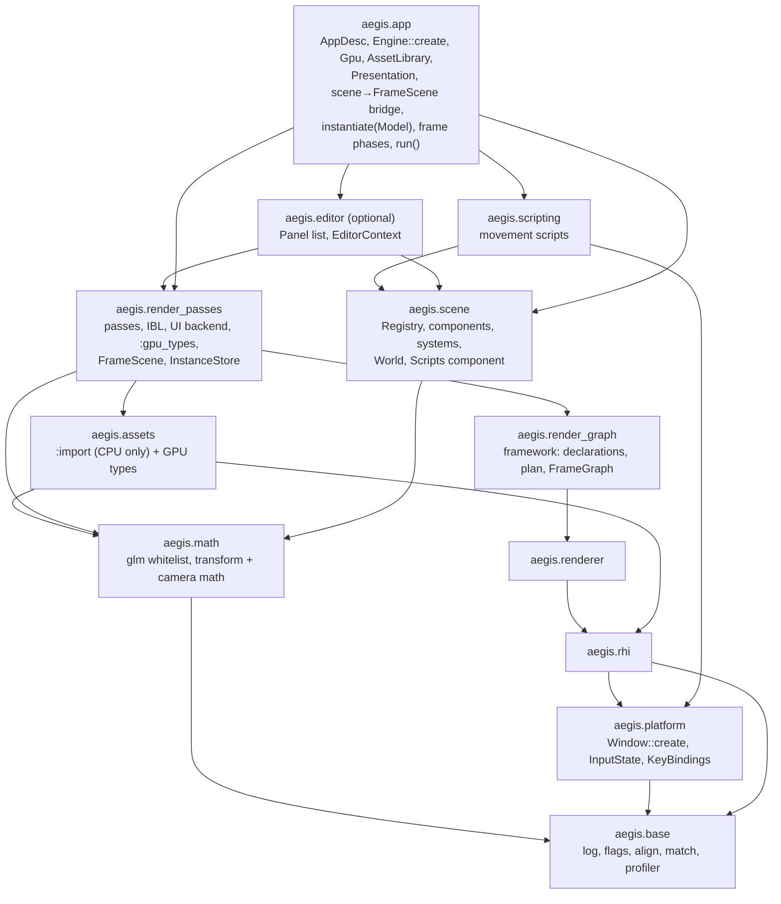

# Aegis engine foundation audit: report

Audit of `C:\Workspace\repos\aegis-engine` at `5c4b20d9` (branch `style/legacy-conversion`), October 2026. Read-only. The detail behind every ID is in `docs/audit/findings-*.md`. Verdicts, corrected facts and canonical IDs come from `docs/audit/verify-*.md`, and they override the findings files where the two disagree. Merged IDs appear in parentheses after the canonical one.

The judging questions throughout: (1) does it make adding features cheaper or safer, (2) does it make the code easier to understand and change, (3) does it make logic unit-testable without a GPU.

---

## 0. What works well and should not change

These are deliberate strengths. Several proposals below depend on them. Don't trade them away during cleanup.

**Render stack**
- **One shared pipeline layout, bindless descriptors with fixed slots, and buffer device address.** A new shader needs a push-constant struct and nothing else on the descriptor side. This also removes the hardest part of permutations, layout compatibility (A-RENDER §5, A-BUILD §5).
- **Generational handles plus deletion keyed on timeline values, including deferred return of bindless slots.** Stale handles can be detected. `shared_ptr` assets can release from anywhere in the frame. The keying extends naturally to per-queue retire values.
- **`Desc` structs, `create() -> std::expected`, dependencies passed in** (Context → Device → Renderer → FrameGraph). This is what lets `aegis-test` build the stack headless. The app proposal copies the pattern.
- **Declared usages drive both usage flags and barriers.** Passes write no sync code (Bloom's mip chain is the one exception), and the barrier model is small enough to reason about.
- **Pure scheduling in `:schedule`, and pure helpers in `detail`** (`RingAllocator`, swapchain policy, mip math, `grownCapacity`), all with tests. This is "extract, don't mock" working.
- **`ResourcePool::resizeBuffer` keeps graph handles stable** while the GPU address changes.
- **The headless/offscreen `Renderer` mode.** It is the only reason device behaviour has a pass/fail signal at all.
- **`UploadManager`'s non-blocking contract**: `NotReady` means flush and retry, there is an overflow path, and batches form a ring. It is the right shape for streaming.
- **`Device` as an explicit hub with per-type overloads.** Don't replace it with a generic `create<T>` until a third or fourth pooled type exists (A-RENDER trace 2.2).

**Content and platform**
- **`MeshPreprocessor` + `MeshData`**: a pure CPU stage with `expected` validation and tests. It is the model for the rest of import.
- **`assets::Error`** (code, message, optional `rhi::Error`) already has the target error shape.
- **Failure cleanup in `StaticMesh::create` and `Texture::create`.**
- **Materials as bindless + device-address data.** A new template is data, not a new pipeline layout.
- **`platform` is a leaf module with GLFW as the only backend, and headless never touches GLFW.** Keep both. Don't abstract the backend.

**App layer**
- **`Registry::create`** enforces the required components, and `remove` is compile-time restricted to optional ones.
- **`System::onUpdate(Registry&, float)`** has no globals, so systems are unit-testable as they are.
- **`Entity` is a plain id**, and scene code passes the registry explicitly.
- **The examples are short content code.** They port almost unchanged to scene functions.
- **`aegis-test` already has the target app shape**: `Options`/`parseOptions`, `create() -> expected`, an exit code, a fixed time step.
- **The engine-lifetime vs scene-lifetime split** (layers vs systems) is the right idea. It needs one mechanism, not two.

**Foundation and build**
- **glm included once, behind a whitelist.** That means one configuration and no layout drift.
- **`std::expected` everywhere in the new stack, and no exceptions.**
- **Scalar layout and row-major matrices in every engine shader.** C++ mirrors map member for member.
- **Globbed shader sources, the fail-fast SDK check, `aegis_add_test` (one labelled exe per module), presets with `-Werror` shared with CI, and `external/` as SYSTEM.**
- **`vulkan-module` linked PRIVATE.** It keeps `vk::` out of test TUs, which is what enforces the extract rule.
- **No threads and no pretended thread-safety.** Unsynchronized containers are the right default until a job feature defines real sharing.

---

## 1. Executive summary

**Overall state.** The audit build (Clang debug, SDK 1.4.328.1) is warning-free. `ctest` passes 112/112, including the 3 device tests. `aegis-test` runs the triangle, `--scene` and `--gpu-driven` paths headless, plus the windowed `--frames 600` run, all with exit 0 and no validation output. The CPU and GPU-driven screenshots match.

The render stack (rhi → renderer → render_graph, about 11k lines) has a sound core. Its friction sits at the authoring edge: how passes declare and wire resources, and the unguarded CPU/GPU data boundary.

The app layer (engine, scene, scripting, editor, about 2.6k lines plus `engine.cppm`) holds most of the verified bugs. Nearly all of them are pure CPU logic in a module that has no test target.

Errors come in four shapes. Frame-loop failures are silent, and release builds run into undefined behaviour at setup. Unit tests cover the extracted leaves well, but no orchestrator: graph compile, upload planning, glTF import and the scene hierarchy are all untested. CI runs no GPU code and no shader validation.

**"Adding a feature means adding code in an obvious place" holds only partly today.**
- A new render pass is mostly additive, but wrong wiring is silent.
- A new component, editor panel, engine-wide system, glTF feature or texture format each requires edits to central files (traces in A-APP §2, A-CONTENT §2, A-RENDER §2).

The fixes are mostly small. One part is large: the app layer, which `docs/engine-architecture.md` already plans to rewrite.

**The ten most important findings**

| # | Finding | Canonical IDs | Why it matters |
|---|---|---|---|
| 1 | GPU-driven static instances are a one-time snapshot while batch counts follow the live ECS. Editor "Destroy Selected Entity" makes culling read a freed mesh buffer and drop or duplicate draws. Adding the editor's "Default Material" to the camera and destroying it wraps a counter to `UINT32_MAX`. | B-RENDER-04 (A-RENDER-01, B-APP-06), E-RENDER-06 | Default render path on mesh-shader GPUs; reachable with one editor click |
| 2 | Scene edits are invisible and hierarchy math is wrong. Static entities are never re-transformed (Simple-Scene's teapot doesn't rotate). Parent rotation and scale are ignored. Reparenting corrupts sibling lists. The gizmo works in local space as if it were world space. | B-APP-01, B-APP-02, B-APP-03, B-APP-04 | Every editor, scripting and model-loading feature sits on this; all pure logic, zero tests |
| 3 | The task shader emits mesh tasks from one invocation (VUID-RuntimeSpirv-TaskEXT-07117), its wave compaction assumes 32 lanes, and the culling radius uses matrix rows instead of columns. | B-BUILD-01, B-BUILD-02 (UNVERIFIED), B-BUILD-03 | Pass on the dev GPU; no tool or validation catches them |
| 4 | Render-graph authoring: each resource is declared twice and never cross-checked, wired by unchecked strings with first-match resolution, and planning is interleaved with GPU creation. Readers always follow the last writer, and independent passes run in reverse add order. | A-RENDER-03 (E-RENDER-01), A-RENDER-04, A-RENDER-05 (B-RENDER-08), E-RENDER-02/03/05 | The main extension point; default-graph wiring is only checked on a GPU, which CI lacks |
| 5 | Four error shapes, and causes are dropped. `renderFrame` returns `void` (device lost means a silently frozen window). Release setup dereferences failed `expected`s. Public-boundary validation is assert-only (a 4-byte heap overflow in `setParameter`, an over-read in `Texture::create`). | A-FOUND-01 (C-02, D-07, D-22), B-RENDER-03, B-APP-12 (C-01, D-27), B-CONTENT-01, B-CONTENT-12 | Every new module copies one of the shapes; release builds are unsafe |
| 6 | Model import is one GPU-bound pass. Nothing past parsing can be tested. Verified glTF bugs: VEC4 `COLOR_0`, data-URI images, ignored topology, every node instantiated, Sponza's alpha-mask and double-sided materials dropped. `assets` builds ECS entities, an upward edge. | A-CONTENT-01/02/08 (E-CONTENT-01/08), B-CONTENT-02..06 | Every content feature lands in the monolith |
| 7 | About 20 hand-mirrored CPU/GPU structs are checked only by `sizeof <= 128`. Constants such as group sizes and meshlet limits are duplicated as literals. There is no `spirv-val`, although a slangc bug that emits invalid SPIR-V is documented. | A-BUILD-01 (E-BUILD-02, D-03), A-BUILD-02, A-BUILD-06 | Wrong data renders with no validation error |
| 8 | A reference returned by `Device::get` dangles when a pool grows during a buffer upload over 32 MB. | A-RENDER-02 | Streaming and large uploads; blocks multithreaded recording |
| 9 | One test case silently never runs (a `;` in its name). Device tests never run in CI. There are no scene tests, and tests/README and AGENTS.md state stale facts. | E-BUILD-01, E-RENDER-13 / A-BUILD-10, A-APP-10, map M1–M16 | "N passed" can't be fully trusted |
| 10 | Dead weight: about two thirds of math/utils, three dead scripting modules, the unbuilt `ai/`, the unlinked `aegis-gltf` submodule and `AssetManager`. | A-FOUND-06, A-APP-13, A-BUILD-09, D-17 | Reading cost; it also causes the U3 upward edge |

**Recommended direction**, in order:
1. Land the verified bug fixes as small independent PRs.
2. Add `tests/scene` and compile-only render-graph tests.
3. Adopt one error/log/assert policy with a small `aegis.base` module, and delete the dead code.
4. Split CPU import from GPU upload in `aegis.assets`.
5. Rewrite the app layer as `aegis.app` along `docs/engine-architecture.md`, amended (section 3).
6. Introduce a minimal `FrameScene` before the first new feature pass (terrain, vegetation, shadows) is written.

---

## 2. Target architecture

### 2.1 Dependency diagram

Rules:
- Arrows point down the layer order only.
- No new-style module imports `aegis.scene`.
- `aegis.app` is the only place that knows both the ECS and the renderer.
- `core` and `utils` are gone: their live parts move to `base` and `app`.
- Examples, `aegis-test` and unit tests sit on top.

### 2.2 How it differs from today

| Area | Today | Target | Driver |
|---|---|---|---|
| Foundation | `math` (partitions); `utils` (dotted, mostly dead); `core/assert.h` reached by a `..` include; generic helpers live in `rhi::utility`; the aegis-log singleton is null until `Engine` exists | `aegis.base` (log, flags, align, `match`, timer/profiler) plus `aegis.math` (glm whitelist, quat transform, camera and normal-matrix math). `utils` is deleted; `core` dissolves | A-FOUND-02/03/05/06 |
| Upward edges | U1 assets → scene, U2 render_graph → scene, U3 math/utils → core header | None | A-CONTENT-01, A-RENDER-07, A-FOUND-02 |
| Assets | Parse, decode, upload and create entities in one pass; `core::Asset` base; components in assets | CPU `:import` (`ModelData`, `ImageData`, no Device) plus thin GPU upload; `instantiate(Registry&, Model)` in the app; components move with it | A-CONTENT-01/02/05/08 |
| Render graph | One target holds the framework, passes, IBL and the ImGui backend. `FrameInfo` holds `Scene&`. Resources are declared twice. The Renderer owns resolution-dependent textures | A device-free declaration table plus a pure `compilePlan`; one declaration per access; the graph owns all its textures; framework and passes in separate targets; passes read a `FrameScene` | A-RENDER-03/04/06/07, A-BUILD-07 |
| Scene | Scripts kept beside the ECS (raw `new`); slots as an id side table; `reset()` is a TODO; the static/dynamic rule lives in a comment | World = `scene::Scene` grown in place: Scripts component + ScriptSystem, `MainCamera` tag, real `reset`, a static change counter | A-APP-01/04/08 |
| App | Singleton `Engine` with 10 static accessors, 16 order-dependent members, everything inline; editor always on; re-exports the whole engine | `aegis.app`: `Engine::create(AppDesc) -> expected<unique_ptr>`, plain service structs, named frame phases, optional editor, narrow re-export | engine-architecture.md, A-APP §4, A-APP-12 |
| Platform | `Window` asserts, and each window terminates GLFW; `Input` is welded to GLFW | `Window::create -> expected`; GLFW is initialized once; value types `InputState` and `KeyBindings` | A-CONTENT-11/13 |
| Errors | Four shapes; causes dropped | One per module, all the same shape, plus `describe()` | A-FOUND-01 |
| Build | Two shader recipes, no `spirv-val`; three path mechanisms leaked as PUBLIC macros | One `aegis_add_shaders` with `spirv-val`; one `AEGIS_`-prefixed path value read in one TU | A-BUILD-05/06 |

### 2.3 Target code style (one style replacing the two)

1. **Modules.** One module per subsystem, `aegis.<name>`. Internals are partitions, each file named after its partition. The umbrella re-exports the public partitions, and a partition it does not re-export carries a one-line "internal" comment. No dotted submodules: convert them when a module is rewritten, never as a sweep.
2. **Files.** `.cppm` declares. Non-template bodies longer than one line go in a `.cpp`.
3. **Namespaces.** Use `aegis::<module>`; nothing sits in bare `aegis`. Helpers exposed only for tests go in `aegis::<module>::detail`. Reusable functions don't go in `detail`.
4. **Signatures.** Trailing return types. `[[nodiscard]]` is mandatory on returns of `expected`, handles and owners, and optional on getters.
5. **Errors.**
   - A fallible operation returns `std::expected<T, <module>::Error>` and never throws.
   - Every module's `Error` has one shape: `{ErrorCode code; std::string message; std::optional<Lower::Error> cause}`. rhi has no cause and keeps its debug `source_location`.
   - Build errors with two `makeError` overloads, `(code, msg)` and `(lowerError, msg)`. Print them only through `describe(const Error&)`, which appends the cause chain.
   - A layer adds context and never re-stringifies.
   - `std::ignore` on a fallible call needs a one-line reason.
   - Frame functions that can fail (`renderFrame`, `resize`, `flushUploads`) return `expected`.
6. **Asserts.**
   - Plain `<cassert>` `assert(cond && "msg")` is for programmer errors and internal invariants only. Never assert on file contents, user input or device results.
   - Use `std::unreachable()` for unreachable code.
   - `AGX_ASSERT*` and `core/assert.h` are retired as the legacy code is rewritten.
7. **Logging.**
   - `aegis::log::{warn,error}` writes to stderr with a severity tag, needs no setup, and can be redirected with one `setSink`.
   - Library code logs only degraded behaviour that carries on ("no environment; skipping lighting"). Errors are returned, and only the top level logs them and turns them into an exit code.
   - `std::print` is allowed in `aegis-test`, examples and tools.
8. **Creation.**
   - Use `static create(...) -> expected<T, Error>`.
   - Use a nested `Desc` when a call has two or more non-obvious parameters or any optional one. A single obvious dependency stays positional.
   - Runtime tunables are named `Settings`, not `Desc`.
9. **Ownership.**
   - GPU resources are generational handles resolved through `Device::get`.
   - CPU assets use `shared_ptr`/`unique_ptr`. No raw owning pointers.
   - No singletons or static accessors: dependencies arrive through `create`, the constructor, or a context struct.
10. **Names.**
    - `…Handle` is a pooled, generational, checked reference.
    - `…Descriptor` is a bindless slot index.
    - `…Id` is a plain index.
    - Members are `m_camelCase`, statics `s_`. Plain data structs have no prefix.
11. **Vulkan.** `vk::` and `import vulkan_hpp` appear only in rhi, plus the documented `ui_pass.cpp` exception. rhi classes expose native handles for interop under one accessor spelling.
12. **Purity.**
    - Pure logic is separated from device, GLFW and ImGui code.
    - An orchestrator first computes a plain-value plan, then a thin executor records it.
    - Enum mapping tables you own have no `default:`.
13. **Comments.** Plain `//` stating why and the contracts: ownership, preconditions, errors. No Doxygen tags, no migration or phase notes.
14. **Includes.** Include every std header used, in the global module fragment, and let CI check it.
15. **Shaders.**
    - Scalar layout and row-major matrices.
    - `struct PushConstants` with `[[vk::push_constant]] ConstantBuffer<PushConstants> push;`, declared in entry-point files only.
    - Every C++ mirror lives in a `:gpu_types` partition, carries a layout check, and has a comment naming its Slang twin.
16. **CMake.**
    - Link PUBLIC what a `.cppm` imports, PRIVATE what only a `.cpp` imports, and nothing else.
    - Path definitions are PRIVATE, `AEGIS_`-prefixed and read in one TU.
    - Shaders compile only through `aegis_add_shaders`.
17. **Tests.**
    - Files: `tests/<module>/<unit>.test.cpp`.
    - Suites: `TEST_SUITE("<module>::<Type or function>")`, without `aegis::`; several suites per file are fine.
    - Cases: present-tense `TEST_CASE`, `CHECK` over `REQUIRE`, no `;` in a name.
    - Never test an assert-then-fallback.
18. **Formatting.** clang-format owns it. Mechanical commits go in `.git-blame-ignore-revs`.

**Reconciliations and conflicts**

- **C-02 vs D-07: resolved in favour of D-07 and A-FOUND-01 (one type per module, same shape), not one global `aegis.error`.**
  - Callers branch on module codes today: `upload.cppm` retries on `NotReady`, `renderer` resizes on `OutOfDate`, `test/main.cpp` checks `FormatNotSupported`.
  - One engine-wide enum would couple every module and grow into a catch-all.
  - C-02's real goal, "one `if (!r) log(r.error())` call", is met by a `describe()` per module.
  - The cost is four small functions. This stays an owner decision (§8).
- **Assert policy (C §3 rule 6 vs A-FOUND-04): plain `assert`.**
  - A-FOUND-04's goals are all met by retiring `AGX_ASSERT`: one assert family, no `..` include hack, `std::unreachable()`, and no asserts on input.
  - The new stack already uses `assert` (62 sites); `AGX_ASSERT` has 42 sites, 10 of them in code deleted below.
  - Until the legacy code is gone, fix B-FOUND-02: print to stderr, and let the call site trap.
- **Logging (C row 32 / rule 14 vs A-FOUND-03): both apply.**
  - Errors are returned (C).
  - A setup-free `log` partition carries warnings and validation messages (A-FOUND-03). It replaces 8 `std::println` sites and the null-singleton crash.
- **D-25 "rename `Settings` to `Desc`" is refuted** (verify-conventions §5). `Settings` stays for runtime tunables.

---

## 3. Proposals, ranked

Ranked by (extensibility + testability benefit) / (effort + risk). Sizes: S is under 5 files or about a day; M is one module or several PRs; L crosses modules.

| Rank | Proposal | Fixes / enables | Size | Risk |
|---|---|---|---|---|
| P1 | `tests/scene` plus hierarchy, transform and camera fixes through pure helpers | B-APP-02/03/04, A-FOUND-08, B-FOUND-01, E-APP-09; first app-layer tests | S | Low |
| P2 | Render-graph authoring safety: schedule rules, one declaration per access, device-free declarations plus `compilePlan`, compile-only default-graph tests, graph-owned textures | A-RENDER-03/04/05(b)/06, E-RENDER-01..05/11 | M | Medium (touches every pass constructor, mechanically) |
| P3 | CPU/GPU contract guard and shader build helper with `spirv-val` | A-BUILD-01/02/06, B-BUILD-06, E-BUILD-03 | S–M | Low |
| P4 | Error, log and assert policy; `aegis.base`; delete dead code | A-FOUND-01..06, B-RENDER-03 (a), D-22/23 | M (mostly mechanical) | Low |
| P5 | Content: split CPU import from GPU upload; move instantiation out of assets | A-CONTENT-01/02/03/05/08, B-CONTENT-01..06, E-CONTENT-14 | M | Medium |
| P6 | Platform input as values; `Window::create` | A-CONTENT-11/13, B-CONTENT-11, E-APP-06 | S–M | Low |
| P7 | **Bold: rewrite the app layer as `aegis.app`** (engine-architecture.md, amended) | A-APP-01/04/07/08/11/12/14, B-APP-05/08/10/12/14, D-05 | L (6 PRs) | Medium–high |
| P8 | Minimal SceneView (`FrameScene` + `InstanceStore`), then split render_graph | B-RENDER-04 (structural fix), A-RENDER-07/10, A-BUILD-07 | M | Medium |
| P9 | Verification tiers: golden images, then lavapipe in CI | E-RENDER-13, A-BUILD-10/11 | M | Medium (lavapipe feature coverage unverified) |

### P1. Scene test target and pure scene math (S)

**Problem.**
- B-APP-02: composition is componentwise. Repro: a parent rotated 90° about Z with scale 2 leaves a child at (1,0,0) instead of (0,2,0).
- B-APP-03 (A-APP-03, E-APP-02, E-APP-03): `addChild` doesn't detach from the old parent, `removeChild` leaves `Siblings`, and cycles are not rejected. Reproduced.
- B-APP-04 (A-APP-05, E-APP-12): the gizmo draws the local matrix with world view and projection.
- A-FOUND-08: `inverseViewMatrix` stores +f; `|view·inverseView − I| = 2.0`.
- B-FOUND-01 (E-FOUND-02): `decomposeTRS` loses mirror and rotation, and produces NaN at zero scale. Reachable through the inspector's Scale field plus a gizmo drag.
- E-APP-09: `entityCount` counts destroyed entities.
- No `tests/scene` exists (A-APP-10, E-APP-01).

**Design.**
- Add `aegis-tests-scene` linking `aegis-scene`. Make `aegis-math` and `aegis-core` PUBLIC in `scene/CMakeLists.txt`, since they are re-exported. This is hygiene: A-BUILD-08 was reclassified to polish because a probe showed that a PRIVATE-linked static library still works.
- Add `scene::detail::compose(parentGlobal, local)` and `detail::toLocal(parentGlobal, world)`. `TransformSystem::onBegin` and `onUpdate` share `compose`, and the gizmo manipulates `GlobalTransform::matrix()` and converts back with `toLocal`.
- Fix `addChild`, `removeChild` and the descendant check.
- Move the camera math into `aegis.math`: `viewMatrix`, `perspectiveZeroToOne`, `normalMatrix(mat4)`. `CameraSystem` keeps one-line calls.
- Fix `decomposeTRS`: on a negative determinant, flip one axis; normalize the quaternion; keep the previous rotation on zero scale.

**Unlocks.** Tests 1–7 in §4.3. A correct base for every editor, scripting and model feature. The `Registry` is pure, so this is the cheapest test win in the codebase.

**PRs.**
1. `test/scene-target`: the target, the link fix, and Registry tests with the fixes.
2. `fix/transform-composition`: `compose`, `toLocal`, the gizmo.
3. `fix/camera-and-decompose-math`: camera math into `aegis.math`, the `decomposeTRS` contract, tests.

**Risks.** Fixing B-APP-02 changes how models with rotated or scaled parents render. Only MetalRoughSpheres node 0 has such a parent, and its children carry no translation, so bundled scenes should look the same. Check with screenshots.

### P2. Render-graph authoring safety (M)

**Problem.**
- A pass declares each access twice: the `add*` call in its constructor and again in `info()`. Edges and barriers come only from `info()`, usage flags from every declaration (A-RENDER-03).
- References resolve by name, taking the first match. There is no duplicate or kind check, and formats are copied as literals (A-RENDER-04 ← E-RENDER-04, E-RENDER-11, D-01, D-08).
- `compile()` interleaves the pure plan with GPU creation, and `ResourcePool` needs `Device&` and `Renderer&` just to store declarations (E-RENDER-01). So the default graph's wiring, about 49 string literals, is checked only on a GPU.
- Readers depend on the last producer, so adding a writer silently reorders earlier readers (A-RENDER-05 (b) ← B-RENDER-08; reproduced: A, B(read X), C(write X) gives `0 2 1`).
- Independent passes run in reverse add order (E-RENDER-05; the live run shows Instance Update before Scene Update).
- `default:` in four `Usage` tables silences `-Wswitch` (E-RENDER-03).
- A pass touching one image in two layouts gets both barriers up front (E-RENDER-02).
- Resolution-dependent textures are owned by the Renderer and leak on graph rebuild (A-RENDER-06 ← B-RENDER-07).

**Design.**
- **Schedule (pure).**
  - A stable topological sort: among ready passes, take the lowest add index.
  - Read-before-overwrite: a reader declared before a writer runs before it, with a write-after-read edge.
  - Remove `default:` from the tables.
- **Declarations.**
  - `FrameGraph::add<T>` sets the current pass index before it constructs `T`, so each `add*` records the access for that pass. Reads and writes are derived from `isWrite(usage)`.
  - `RenderPass::info()` becomes `name()`.
- **Plan/execute split.**
  - A device-free `ResourceDeclarations` (today's `m_entries` and `add*`) is what pass constructors receive.
  - `detail::compilePlan(entries, passes) -> expected<GraphPlan, Error>` resolves references and rejects duplicates, kind mismatches, two-layout accesses and unknown names. It also merges usages, orders the passes and plans transitions.
  - `compile()` becomes: plan → create resources from the plan → pass `createResources` → query pools.
  - `ResourcePool::format(handle)` replaces the format literals.
  - Shared names become `constexpr std::string_view` constants.
- **Ownership.** The `ResourcePool` owns every graph texture, and `FrameGraph::resized(extent)` recreates them. `Renderer::createResolutionDependentTexture` and `scaleFactor` are deleted, and `resize` returns `expected`.

**Unlocks.**
- Compile-only tests of the real `addDefaultPasses` graph, for both paths, in CI.
- A plan snapshot: order plus per-pass transitions in a checked-in text file, so every scheduling or barrier change shows up as a diff.
- Runtime graph rebuilds (the GPU-driven toggle, pass hot reload).
- `render_graph` tests stop needing a device.

**PRs.**
1. `fix/schedule-order`: stable tie-break, write-after-read edges, no `default:`, tests.
2. `refactor/graph-declarations`: a mechanical commit changing 13 constructor signatures, then a logic commit for single declaration and `compilePlan`, plus tests.
3. `feat/graph-owned-textures`: A-RENDER-06.
4. Optional: `GBuffer` struct (D-01) and `RenderSystemList` (A-RENDER-12).

**Risks.**
- Reordering independent passes changes the timing panel's order, which is intended.
- Mistakes in the plan port would show as sync-validation errors. Run all three device tests on each PR.

### P3. CPU/GPU contract guard and shader build (S–M)

**Problem.**
- About 20 mirrors are checked only by `sizeof <= 128`.
- `TextureDescriptor` is redefined 3 times, and `descriptorOf`/`storageIndex` are duplicated (A-BUILD-01 ← E-BUILD-02, D-03, B-BUILD-11).
- Group sizes, meshlet limits, `MAX_POINT_LIGHTS` and view-mode enums are duplicated literals (A-BUILD-02 ← B-BUILD-08, E-BUILD-04, B-CONTENT-13).
- `indirect_draw.slang` has a module-scope push constant that breaks the first reuse of `getInstance`: the probe failed `spirv-val` with VUID-06674 (B-BUILD-06).
- The PBR template order lives inside a device-owning factory (E-BUILD-03).
- There are two shader compile rules, and neither runs `spirv-val` (A-BUILD-06 ← E-BUILD-05, B-BUILD-10).

**Design.**
- Add `rhi::TextureDescriptor{SampledImageDescriptor, SamplerDescriptor}` and `Texture::descriptor()`. Use typed `rhi::*Descriptor` members in mirrors, so a storage/sampled mix-up is a compile error. Add `ResourcePool::storageDescriptor()`/`sampledDescriptor()`.
- Add a `:gpu_types` partition per owning module with `sizeof`/`offsetof` layout tests, written once next to each Slang struct.
- Add `assets::detail::addPbrParameters(MaterialTemplate&, …)` and PBR name constants, and test them against `PbrMaterial`.
- Keep push constants in entry-point files only. `indirectDraw::getInstance` takes its inputs as parameters.
- Add `cmake/AegisShaders.cmake` with `aegis_add_shaders(...)`, used for both `shaders/` and the test shader. It runs `spirv-val --target-env vulkan1.3 --scalar-block-layout` after `slangc`, and tries `DEPFILE` with slangc's `-depfile`. verify-build confirmed `-depfile` works in 2025.17.2; whether Ninja accepts its Make-escaped paths is unchecked.
- Device tests are registered only when shaders compile. The GPU-driven test gets a `mesh-shaders` label and a skip code.
- Later, with the material system: `-reflection-json` feeds generated `static_assert` offsets (E-BUILD S1). Group sizes can come from SPIR-V `LocalSize` through a pure `detail::reflectEntryPoint` (A-BUILD-02).

**Unlocks.** Layout drift and invalid SPIR-V become build failures in CI with no GPU, and new passes copy one helper instead of three.

**PRs.**
1. `build/shader-helper-spirv-val`.
2. `refactor/typed-texture-descriptor`.
3. `test/gpu-types-layout`.
4. `fix/indirect-draw-push-constant`.

**Risks.** `spirv-val` may reject current output from the known slangc bug class. That is the point: fix or work around it in that PR.

### P4. Error, log and assert policy; `aegis.base`; dead-code removal (M, mostly mechanical)

**Problem.**
- Four error shapes, causes dropped, and `QueueSubmitFailed`/`SwapchainPresentFailed` never produced (A-FOUND-01).
- The logger dereferences null before `Engine` exists (reproduced segfault), and the render stack `println`s to stdout (A-FOUND-03 ← B-FOUND-04, D-23).
- Asserts are used for input validation and arrive through an include hack (A-FOUND-04).
- There are three flag-enum implementations, and the generic one applies to every enum under 13 using-directives (A-FOUND-05).
- The live generic helpers live in rhi, and `aegis.utils` is mostly dead (A-FOUND-02, A-FOUND-06).
- Print-and-continue and `std::ignore` on fallible calls are scattered around (D-22).

**Design.**
- `aegis.base` holds `:log`, `:flags` (an explicit opt-in that ADL can see, so `Format | Format` stops compiling), `:align`, `:match`, and the profiler with `Timer` on `steady_clock` and a public constructor (E-FOUND-06, E-APP-11). Each item has at least two importing modules today.
- The error shape from §2.3 rule 5. `renderer::Error` becomes a struct, `render_graph::Error` gains codes, and rhi gains `InvalidArgument` and `OutOfDescriptors`.
- `renderFrame`, `resize` and `flushUploads` return `expected`.
- Delete the dead code, with the verdicts from verify-conventions §3 (plan in §7, M2).

**Unlocks.**
- One `check` for every module.
- Actionable messages ("compile frame graph: create texture 'X': out of device memory").
- Logging that works under doctest, with a capturing sink.
- A home for low-level code below rhi.
- About 2,000 fewer lines to read, counting `ai/`.

**PRs.** Deletions (several PRs), then `aegis.base`, then errors one module at a time (rhi → renderer → render_graph → assets).

**Risks.** Mostly churn. The error PRs touch every `makeError` site, so keep each module's PR self-contained.

### P5. Content: CPU import, GPU upload, instantiation (M)

**Problem.**
- `GltfImport` parses, decodes, uploads and builds entities in one pass, and fastgltf is PRIVATE, so nothing past parsing is testable (A-CONTENT-02 ← E-CONTENT-01).
- `Texture` has decoders built in, with seven factories (A-CONTENT-08 ← E-CONTENT-08).
- `assets` imports `aegis.scene` (A-CONTENT-01).
- Every loader shares one mutable default material (A-CONTENT-03 ← E-CONTENT-04).
- The verified glTF bugs: B-CONTENT-02/03/05/06 plus B-CONTENT-04.

**Design** (A-CONTENT §4, E-CONTENT S1–S4).
- A CPU-only `:import` partition that imports neither rhi nor scene:
  - `ImageData` and `decodeImage(span)`;
  - `ModelData{meshes, images, materials (factors, texture indices, alpha mode and cutoff, double-sided, texCoord, sampler), nodes, roots, warnings}`;
  - `importGltf(path | bytes)` and `importObj(istream)`.
- The GPU side: `Texture::create(Device&, const ImageData&, sampler)`, which validates the size, and `upload(Device&, ModelData&&, defaults) -> expected<Model>`.
- `instantiate(Registry&, const Model&)` moves to the app, together with the `Mesh`/`Material` components.
- Material validation returns `expected` (B-CONTENT-01).
- A fresh default material instance per load (A-CONTENT-03).
- Define the asset key now (`AssetKey{relative path, subIndex}`, A-CONTENT B4), because scene files will persist it.
- Delete `core::Asset` once the key exists (A-CONTENT-05).

**Unlocks.**
- In-memory fixture tests: glTF JSON with `data:` buffers, OBJ strings, PNG bytes.
- Skins, KTX2 and texture transforms become additive.
- A worker thread can import later without touching `Device`.
- U1 goes away.

**PRs.**
1. `feat/image-data-decode`.
2. `feat/model-import` (with tests).
3. `refactor/instantiate-in-app`, which removes `aegis-scene`/EnTT from the assets links.
4. `refactor/remove-core-asset`.

**Risks.** Decoded images stay in CPU memory until upload; that is acceptable at startup. Glue code changes in `Engine::loadModel` and `aegis-test`.

### P6. Platform input as values (S–M)

**Problem.**
- `Input` installs itself into `Window`'s single handler slot through `friend` and polls GLFW. Binding logic is reachable only through a live window (A-CONTENT-13 ← E-CONTENT-10, E-APP-06).
- Bindings can't be removed, and binding inside a callback is UB (B-CONTENT-11).
- `Window` asserts, never checks `glfwInit`, and terminates GLFW per window (A-CONTENT-11 ← B-CONTENT-10, E-CONTENT-13). The corrected consequences are a hang, or a Vulkan error with GLFW's reason never printed; not a crash.
- `Key::Unknown` raises 4 GLFW errors per frame, unseen because no error callback is installed.

**Design.**
- `platform::KeyBindings` value type: `bind -> id`, `unbind`, and `dispatch` iterating by index over a snapshot.
- `InputState` (key bitset, buttons, cursor, deltas) captured once per frame. Scripts read `const InputState&`, which is empty while ImGui captures input.
- `Window::create -> expected`, GLFW initialized once, move assignment deleted, a GLFW error callback through `log`.

**Unlocks.** `tests/platform`, script tests (B-APP-09 pinned), and headless engines without a window.

**PRs.** `feat/key-bindings`, `feat/input-state`, `fix/window-create`.

### P7. Bold option: rewrite the app layer as `aegis.app` (L)

**Why bold, and why justified.**
- Converting `engine.cppm`, `scene_defaults`, `scene_description`, `ui`, the editor wiring and `ScriptManager` to the new style in place would be wasted work. Most of the app-layer bugs live in exactly that code.
- engine-architecture.md already replaces it. The real choice is between porting module by module and rewriting the app shell against the kept parts: `Registry`, components, systems, examples' content code.
- Recommendation: rewrite the shell, keep and fix the parts.

**Problems it removes:**
- the singleton and static accessors (EA-1);
- release UB at setup (B-APP-12, B-APP-13);
- compiled-in configuration (EA-3);
- member-order traps (EA-4, B-APP-14);
- no reset, and leaked scripts that dangle after destroy (B-APP-05, C-03);
- scripts living beside the ECS (A-APP-08);
- no frame phases (A-APP-07), with B-APP-10 and B-APP-11 as their bug facets;
- input not arbitrated (B-APP-08);
- the editor built in and coupled to render types (A-APP-11, A-APP-14);
- a facade that re-exports everything (A-APP-12);
- duplicated startup in `aegis-test` (D-05).

**Design.** engine-architecture.md as amended in the verdict table below. The core of it:
- `Engine::create(AppDesc) -> expected<unique_ptr<Engine>>`, with services as plain structs: `Platform?`, `Gpu`, `AssetLibrary`, World, `Presentation`.
- `run(argc, argv, desc, scenes) -> int`.
- Phases: input → pre-update (commands, reloads) → update → post-update (transforms, then camera, with the aspect from the renderer) → extract → render → present.
- A `FrameClock` that clamps the delta, or uses a fixed step with `--frames`.
- Scripts as a component.
- An optional editor with a `Panel` list.

**Unlocks.**
- Every example becomes a `device` CTest (`--headless --frames N`).
- `aegis-test --scene` exercises the real app path.
- New engine-wide systems, panels and scenes become additive.

**PRs** (one per step; mechanical commits separate):
1. AppDesc, CLI, `create -> expected`, headless mode, exit codes, examples as CTests through `aegis_add_example`.
2. Remove the globals: `engine.cpp`, the services, a narrow re-export.
3. World lifecycle: Scripts component and ScriptSystem, real `reset`, slots replaced by components, opt-in default helpers, named scenes.
4. Phases, `FrameClock`, `InputState` with capture, an editor safe point.
5. ImGui owned by Presentation; optional editor with `Panel`/`EditorContext`.
6. `aegis-test --scene` through `app::Engine::create`; split `test/main.cpp` into `checks/*.cpp` (C-08, D-05).

**Risks.** Large. Mitigation: the bug fixes in §7 M1 land first, each step builds and passes the device tests, and the examples port one per commit.

### P8. Minimal SceneView, then split render_graph (M)

**Problem.**
- Passes read and write the ECS: seven pass bodies read it, and `SceneUpdatePass` writes `camera.aspect` back. The draw-batch registry is reached two ways (A-RENDER-07).
- Static instances are a snapshot (B-RENDER-04).
- The CPU and GPU paths disagree on what to draw (A-RENDER-10).
- `aegis-tests-render_graph` links the whole legacy scene stack (A-BUILD-07 ← E-BUILD-07, D-29).

**Design.**
- `FrameScene`: a plain value holding the camera, lights, environment descriptors and `const InstanceStore&`.
- `InstanceStore`: pure. Slot-allocated `InstanceData`, batch bookkeeping and a dirty range. It replaces the counting in `DrawBatchRegistry` and the collection in `InstanceUpdatePass`.
- A bridge in `aegis.app` owns the entt signal handlers.
- `FrameInfo` loses `Scene&`, and `sceneInitialized` goes away.
- Then split the target: `aegis-render-graph` (framework) and `aegis-render-passes`. The split is S once `FrameInfo` no longer names the scene.

**Timing.** Before the first terrain, vegetation or shadow pass. Each pass written against `Scene&` raises the retrofit cost.
- Don't do it for test link time: E-RENDER B8 shows `Scene` is constructible in tests.
- Do the cheap part, extracting `gatherLighting`, `makeCameraData` and `instanceTransform` into `detail` (E-RENDER-08, A-FOUND-11), in P2's wake without waiting.

**Unlocks.**
- Unit tests of `InstanceStore`.
- `aegis-test` rendering a hand-built `FrameScene`.
- Streaming instances in and out.
- A later extract/render split across threads.

### P9. Verification tiers (M)

- **Golden images.** Add `--compare <png> --tolerance` to `aegis-test`, reusing the readback in `verifyOffscreenFrame`. Small references go in `tests/golden/` under a separate `golden` label.
- **lavapipe in CI.** A Linux debug job running `ctest -L device -LE mesh-shaders`.
  - Prerequisites: B-BUILD-01/02 fixed, skip codes in place, the validation layer path set (`VK_ADD_LAYER_PATH`), `--frames 60`.
  - Feasibility is inferred, not verified. Mesh-shader support depends on the Mesa version.
  - E-RENDER-09 (device ranking) should be fixed first, so the device choice is deterministic.

### Deferred until the feature (WITH) and not needed

| Item | When | ID |
|---|---|---|
| Persistent and imported graph images, subresource tracking, batched barriers, graphics-stage storage usages | With terrain/TAA | A-RENDER-05 (a)(c), §3.3 |
| Pooled pipelines with deferred `replace`, `ShaderLibrary`, public `Device::retire` | With shader hot reload | A-RENDER-08, A-BUILD-04 (NOW: identify shaders by source name) |
| Shading key per template; keyed pipelines; `GraphicsDesc` additions | With the material system, or to fix Sponza (§8) | A-RENDER-10, B-CONTENT-04 |
| `SubmitDesc` with timeline waits, per-queue retire values, ownership transfer | With async compute or a transfer queue | A-RENDER-09 (NOW: delete the unused queue accessors) |
| `AssetLibrary` cache (key → `weak_ptr`), sampler cache, residency, worker import | With streaming/reload (key format is NOW) | A-CONTENT-04/06/10 |
| Component table with save/load, stable entity ids, undo commands | With editor growth | A-APP-09 |
| Job system, per-thread command pools, thread-safe profiler | With the job feature | A-RENDER §3.6, A-FOUND §2 |
| Transient aliasing | After graph-owned textures | A-RENDER §3.3 |
| Fake `rhi::Device`, `IWindow`/`IInput` interfaces, a reflection system or `entt::meta`, generational asset handles, a GUID asset database, `VK_EXT_graphics_pipeline_library`, a generic `Device::create<T>`, lock-free pools, a C++/Slang shared header | Not needed | E-RENDER §6, E-CONTENT §4, A-APP §3, A-CONTENT §4 |

### Where the current design is fine: don't touch

- **rhi's resource model**: handles, pools, the deletion queue, bindless, BDA, one layout.
- **`Device` as a hub.**
- **`Renderer` frame pacing.** Nothing pure is left to extract once `scaleFactor` is gone.
- **`UploadManager`'s ring and batching**, apart from A-RENDER-02 and the ordering contract in B-RENDER-06.
- **`System::onUpdate(Registry&, float)`.**
- **`Entity` as a value.**
- **`shared_ptr` lifetime for CPU assets.**
- **GLFW as the only backend.**
- **`aegis_add_test` and one exe per module.**
- **The glm whitelist.**
- **Globbed shaders.**
- **No threads.**
- **The `aegis-test` triangle mode** as the minimal RHI-only check.
- **Per-pass local `PushConstants` structs and per-pass `Pipeline::*Desc` setup.** This is acceptable similarity (D §A). P3 only moves the mirrors where tests can name them.

### Verdict on `docs/engine-architecture.md`

| Section | Verdict | Notes |
|---|---|---|
| Intro: "render stack is in good shape, not in question" | Amend | `render_graph` imports the scene (M3) and holds the verified bugs B-RENDER-04 and A-RENDER-02. Its core design is sound. |
| Problems 1–7 | Agree, extend | All still accurate. Add the static/dynamic rule (B-APP-01), hierarchy math and lists (B-APP-02/03), gizmo space (B-APP-04), input capture (B-APP-08) and frame order (B-APP-10, A-APP-07). EA-6: passes also *write* the ECS (`camera.aspect`). Fix `Core::` → `core::` (M14). |
| Proposal tree (five services) | Amend | Services are plain structs of owned members, each created by a function returning `expected`, with no interfaces. World is `scene::Scene` grown in `aegis.scene`, not a type in `aegis.app`: the editor must name it without an import cycle, and it stays testable by linking `aegis-scene` alone. Presentation owns the frame graph, draw batches and ImGui. The editor is a separate, optional, app-owned object in `aegis.editor`. |
| AppDesc and command line | Agree, amend | Reuse `aegis-test`'s `parseOptions`. Add `--scene`, `--no-editor`, a fixed dt with `--frames`, and an asset root replacing `core::ASSETS_DIR`. Drop `fpsLimit`. |
| `Engine::create -> expected<unique_ptr>` | Agree | Use an `app::Error` in the per-module shape. Drop "several engines side by side" as a goal, since ImGui and GLFW are process-global. The real gain is "constructible in a test", which also needs B-APP-13 fixed. |
| Scenes as named functions | Agree, amend | `SceneContext` = `World&` + `AssetLibrary&`, registered as a `{name, fn}` list for `--scene`. Transform and Camera systems are always-present engine systems. Split `createDefaultScene` into opt-in helpers that return their entities. |
| World owns scripts as `unique_ptr` | Replace | Scripts become a component plus a `ScriptSystem` (A-APP-08), so they die with their entity and the editor and serialization can see them. `reset()` = `registry.clear()` plus clearing systems, and it must re-arm the render side. |
| Later: SceneView | Agree, amend timing | Introduce a minimal `FrameScene` + `InstanceStore` before the first new feature pass (P8), not last. Remove render writes to the ECS in the phases step. |
| What stays | Agree | |
| Suggested order | Amend | New step 0: bug fixes plus `tests/scene`. Step 4 gains frame phases, the clock and `InputState`. SceneView runs in parallel once P2 lands. One PR per step, mechanical commits separate. |
| Open decisions | Answer | `aegis.app` (since "engine" already names the library target); convert `scene`/`scripting` where the rewrite touches them; plain functions for scenes. |
| Missing | Add | Frame phases and clock; input capture; the static/dynamic rule; how `aegis-test` reuses the app (`verify*` on the `Gpu` struct, `--scene` through `create`); where the editor lives; what replaces the static asset helpers and `ASSETS_DIR`. |

### Verdict on `src/aegis/ai/`: delete

`ai/` is 33 files and 1,861 lines, unbuilt since the move to modules (A-APP §5).
- Every include points to a header that no longer exists.
- It uses PascalCase namespaces and the removed callback input API, and treats scripts as components.
- A port would be a rewrite against a scripting API that P7 changes, and none of the goals needs it.

Delete it in one PR together with `DynamicMovementController`, `WorldBorder` and `MotionDynamics` (dead, D-14), and remove the `ai/` exception from AGENTS.md. Git history keeps it. If steering is wanted later, write it as a pure, tested module on the new scripting API.

---

## 4. Testability

### 4.1 Per subsystem

| Subsystem | Tested today | Worth testing next | Blocker | Smallest seam |
|---|---|---|---|---|
| rhi | Deep on leaves: ring allocator, mips, swapchain policy, pool, free list, small helpers | Pool reference stability; image upload plan; device and queue-family choice; conversion-table invariants | `vk::` in signatures (B5); assert-only validation (B6) | `detail::planImageUpload` (E-RENDER-07); `detail::rankPhysicalDevice`/`pickQueueFamilies` (E-RENDER-09); `static_assert`s inside `:vulkan_conversions` (E-RENDER-10) |
| renderer | Nothing | Nothing beyond the device tests once `scaleFactor` is gone | — | None (device-tested) |
| render_graph | `schedule`, `frustum`, `grownCapacity`, registry counters (on hand-built inputs only) | Real-graph compile, resolve and usage merge; `DrawBatchRegistry` handlers; per-frame packing | `ResourcePool` needs a device (B1); plan interleaved with creation (B2); logic inside `execute` (B3) | `ResourceDeclarations` + `compilePlan` (P2); `detail::gatherLighting`/`makeCameraData`/`instanceTransform` (E-RENDER-08); registry `track`/`untrack` (E-RENDER-06) |
| assets | `MeshPreprocessor`, material layout | glTF/OBJ mapping, color space, nodes, decode, mip0 size, material validation, PBR layout | `GltfImport` monolith with fastgltf PRIVATE; decode inside factories; asserts | `:import` (P5); `decodeImage`; `expected` validation; `addPbrParameters` |
| platform | Nothing (README claims otherwise, M9) | Key-binding matching, reentrancy, unbind | `Input(Window&)` | `KeyBindings` (P6) |
| math / base | Basis vectors (shallow), `inFOV` | Transform round trip, camera matrices, flags, log sink, `RollingAverage` | None (math is pure) | None; delete the dead parts instead of testing them |
| scene | Nothing | Hierarchy, composition, `entityCount`, system order, static/dynamic contract | No target | `tests/scene` (P1) |
| scripting | Nothing | Script lifecycle, movement controller | `Input&` needs a window (E-APP-06) | `InputState` (P6) |
| engine/app | Nothing; examples not in CTest | Frame clock, update order, real startup | Singleton, inline loop, unconditional `Window`/`Input` | `FrameClock`, a phase function, headless `create` (P7) |
| editor/ui | Nothing | Leave to headless device runs | ImGui | None |
| shaders/build | slangc errors only | Layout, `spirv-val`, PBR order | No reflection; hidden local structs; two recipes | `aegis_add_shaders` with `spirv-val`; `:gpu_types` layout tests (P3) |

### 4.2 Test-strategy verdict

| Option | Verdict | Reason |
|---|---|---|
| Extract rather than mock | **Keep** | Proven on the leaves. Extend it with the two refinements below. |
| Plan/execute separation | **Adopt** for orchestrators: `FrameGraph::compile`, image upload, device selection, glTF import | The next level of "extract": compute a plain plan, unit-test it, and keep the executor thin and device-tested. `sortPasses`/`planTransitions` already work this way; `compile()` stops halfway. |
| Fake or null `rhi::Device` | **Reject** | It would have to fake about 20 create/free overloads, `CommandBuffer`, `Queue` and VMA-backed objects (L-sized, against the design), and it still can't judge whether a barrier is right. A real software Vulkan is the only useful fake. |
| Headless engine mode | **Yes, in P7 step 1** | It turns the examples into device CTests and covers the real startup path. It adds little for render testability beyond `aegis-test --scene`. |
| Golden images | **Yes** (P9) | Tolerance compare, small references, `golden` label. It catches what validation never reports, such as the static teapot and the Sponza materials. |
| Compile-only render-graph tests | **Yes, top priority** (P2) | They prove every name contract and the pass order of both default graphs in CI, and a plan snapshot shows barrier changes in review. |
| lavapipe in CI | **Yes, after the prerequisites** (P9) | It is the only way to exercise executors in CI. Feasibility is inferred, not verified: Vulkan 1.3 features yes; mesh shaders depend on the Mesa version. Run debug only, with `--frames 60`, and set the validation layer path. |

Two refinements to tests/README's rules:
- (a) An extracted CPU stage gets its own partition that imports no rhi, so purity is enforced, as `:ring_allocator` does.
- (b) "Test around asserts" applies only to internal invariants. Public-boundary validation returns errors (E-RENDER §6 "Stop doing").

### 4.3 First batch of tests, in order

Tests 1–6 and 8–12 need no new seam beyond `tests/scene` and fail today where marked; they double as bug reports.

| # | TEST_SUITE / TEST_CASE | Seam needed | Pins |
|---|---|---|---|
| 1 | `scene::Registry` / "keeps both child lists consistent when a child is reparented" | `tests/scene` target | B-APP-03 (a), fails today |
| 2 | `scene::Registry` / "unlinks a removed child and keeps its siblings linked" (SUBCASEs first/middle/last) | same | B-APP-03 (b) / E-APP-02 |
| 3 | `scene::Registry` / "does not count destroyed entities" | same | E-APP-09, fails today |
| 4 | `scene::TransformSystem` / "applies the parent's rotation and scale to a child's location" | same (`detail::compose` optional) | B-APP-02, fails today |
| 5 | `scene::TransformSystem` / "updates only entities with DynamicTag after begin" | same | B-APP-01 contract (documents it) |
| 6 | `math::decomposeTRS` / "round-trips a rotated, non-uniformly scaled transform and keeps a mirrored axis" | none (`aegis-tests-math`) | B-FOUND-01, mirror half fails today |
| 7 | `math::viewMatrix` / "inverse view times view is the identity" | camera math moved into `aegis.math` (P1) | A-FOUND-08 |
| 8 | `render_graph::sortPasses` / "independent passes keep their add order" | none | E-RENDER-05, fails today |
| 9 | `render_graph::sortPasses` / "a reader declared before a writer runs before it" | none | A-RENDER-05 (b) / B-RENDER-08, fails today |
| 10 | `render_graph::Usage` / "every write usage maps to a writing state and every image usage has a layout class" | `default:` removed | E-RENDER-03 |
| 11 | `render_graph::DrawBatchRegistry` / "a material without an instance never moves counts when its entity becomes dynamic" | none (`scene::Registry` + `connect`) | E-RENDER-06, fails today |
| 12 | `render_graph::DrawBatchRegistry` / "connecting twice does not double-count" | none | B-RENDER-05 |
| 13 | `rhi::ResourcePool` / "a returned reference keeps its address while the pool grows" | stable slot storage | A-RENDER-02 |
| 14 | `render_graph::compilePlan` / "rejects two passes creating the same name, naming both passes" | `compilePlan` | A-RENDER-04 |
| 15 | `render_graph::addDefaultPasses` / "the CPU- and GPU-driven default graphs compile to a plan without a device" | `ResourceDeclarations` + `compilePlan` | A-RENDER-03 / E-RENDER-01 (all name contracts) |
| 16 | `assets::MaterialTemplate` / "rejects a value whose type differs from the parameter's default" | `expected` validation | B-CONTENT-01 |
| 17 | `rhi::planImageUpload` / "rejects data whose size does not match the mip chain" | `detail::planImageUpload` | B-CONTENT-12 (E-RENDER-07) |
| 18 | `assets::importGltf` / "imports only the default scene's nodes" (sibling cases: rejects strip topology; reads VEC4 COLOR_0; decodes a data-URI image) | `:import` | B-CONTENT-06, -05, -02, -03 |
| 19 | `platform::KeyBindings` / "survives a callback that binds the same key" | `KeyBindings` | B-CONTENT-11 |
| 20 | `scripting::KinematicMovementController` / "turns by the same angle for the same mouse movement at any frame rate" | `InputState` | B-APP-09 |

Also fix E-BUILD-01 at once (§7 PR 1.1). It is not a test, but it restores a case that never ran.

---

## 5. Conventions

### 5.1 Keep / change / drop

| Convention | Verdict | Note |
|---|---|---|
| Trailing return types | Keep, all code | Legacy is half converted; extend as code is touched |
| `[[nodiscard]]` | Change | Mandatory on `expected`/handle/owner returns, optional on getters; no mass edit |
| `Desc` nested config | Keep | Rule: 2+ non-obvious params or any optional one; `Settings` for runtime tunables (D-25 refuted) |
| `create() -> expected` | Keep | Extend to `Window` and the engine |
| Per-module `Error` + `makeError` | Change | One shape plus `describe()` (§2.3 rule 5) |
| Never throw | Keep | Zero `throw` today |
| `AGX_ASSERT*` | Drop over time | Plain `assert` for invariants; fix B-FOUND-02 meanwhile |
| Handles as public currency | Keep, narrow | GPU resources only; CPU assets use `shared_ptr` (M16) |
| `Handle` vs `Descriptor` | Change | Add `Id` for plain indices; rename `render_graph::ResourceHandle` → `ResourceId` (M10) |
| Bindless + BDA + one layout | Keep | |
| "`vk::` never crosses the public API" | Change the wording | False as written: 16 `vk::`-returning accessors exist (M1). State the interop accessors and the `ui_pass.cpp` exception; one accessor spelling is optional polish (C-05) |
| `.cppm` + `.cpp` | Keep | Applies when legacy is rewritten (C-04) |
| Partitions vs dotted submodules | Change | Partitions everywhere; `math` already uses them (M4) |
| Umbrella re-export | Keep | Comment the non-exported partitions |
| `detail` for test-visible helpers | Keep, clarify | `detail` for test-only helpers; reusable functions go in the module proper |
| Extract, don't mock | Keep | Add plan/execute separation |
| One test exe per module | Keep | |
| Test suite naming | Change | `<module>::<Type or function>`, no `aegis::`; fix the 3 outliers |
| `m_` members, snake_case names | Keep | Fix `m_Layers`; move bare-`aegis` types when ported (C-12) |
| PascalCase example targets | Drop as a convention | Just list the targets; don't rename |
| clang-format, diff-only | Change (owner decides, §8) | The tree is now formatted (b5877948); a CI dry-run check is the alternative |
| Include every std header | Keep, automate | Check in the missing-include scanner (agent-notes idea 4) |
| Shader push-constant naming | Change | `PushConstants` + `push`, entry-point files only |
| Comments | Change | Plain `//`, contracts, no Doxygen tags, no phase notes (M15) |
| `println` vs logger | Change | `aegis::log` for warnings; errors returned |
| Link visibility | New rule | PUBLIC = imported by a `.cppm` (A-BUILD-08) |
| Commit and PR rules | Keep | Add `.git-blame-ignore-revs` (missing) |

### 5.2 Proposed changes to AGENTS.md

1. **Code styles.** Replace the "Two code styles" table with the §2.3 rule list. Add a short transitional note: "legacy modules (`core`, `editor`, `scene`, `scripting`, `ui`, `engine.cppm`, `scene_*.cppm`) are converted when rewritten, not in place". Fix M4: `math` uses partitions.
2. **`ai/` exception.** Delete the `ai/` paragraph and the exception wherever it appears, once `ai/` is deleted.
3. **Vulkan boundary (M1).** Replace "the vulkan module is linked PRIVATE, so `vk::` types never cross their public API" with: "rhi classes expose native `vk::` handles for interop; the vulkan module is linked PRIVATE, so code outside rhi cannot name `vk::` types, and only `render_graph/passes/ui_pass.cpp` imports `vulkan_hpp`, for the ImGui backend."
4. **Handles (M16, M10).** Narrow the handle rule to GPU resources and say CPU assets use `shared_ptr`. Add `…Id` = plain index. Note that `Window::glfwWindow()` exists for the ImGui backend.
5. **Errors (M2).** State the error, log and assert policy (§2.3 rules 5–7). Remove the claim that `platform` follows `expected` until `Window::create` lands.
6. **Shaders (M5, M6, verify-build §5.6).**
   - Output is `build/<preset>/shaders/<rel>.slang.spv`, found through `AEGIS_SHADER_DIR`.
   - Shaders compile when `COMPILE_SHADERS` is ON (the default); `compile_shaders` is a dependency of `aegis-engine` and `aegis-render-graph`.
   - Replace "every shader depends on all modules … slangc reports no per-file dependencies" (also in `shaders/CMakeLists.txt`'s comment). slangc 2025.17.2 supports `-depfile` and `-reflection-json`; until `DEPFILE` is wired up, deps are coarse.
   - Add: "run `spirv-val` on shader output" (until P3 automates it).
7. **Paths (M5).** `aegis-test` has its own `SHADER_PATH`/`ASSETS_DIR`, and `core::SHADER_DIR` is unused. Rewrite the section after the path PR (§7 M3).
8. **Verifying (M11).** `aegis-test` fails on validation messages of severity *error* only; warnings print but don't fail. The count is process-wide.
9. **Layers.** Add the layer order (base, math < platform < rhi < renderer < assets < render_graph < scene/scripting < editor < app) and list U1–U3 as known debt until removed.
10. **CMake.** Add the link-visibility and path-definition rules.
11. **Verification steps.** Add "release builds are part of verification while `AGX_ASSERT` exists" (from agent-notes) and "split a `TEST_CASE` instead of putting `;` in its name".
12. **Targets.** Drop "PascalCase `project()` names" as a convention; list the targets.
13. **Formatting.** Either "the tree is formatted; CI checks `clang-format --dry-run`" or keep diff-only, by owner decision. Mention the `git clang-format` Python workaround or add `tools/format.sh`.
14. **Blame.** Create `.git-blame-ignore-revs` with b5877948, 561096dc and 5c4b20d9 once `style/legacy-conversion` is merged (merge commits keep the hashes).
15. **Unit tests section.** "doctest covers pure, GPU-independent logic on the new RHI stack (plus math)" becomes "pure logic in any module".

### 5.3 Proposed changes to tests/README.md

1. **Scope line.** Replace it with "pure, GPU-independent logic in any module". Remove "`renderer` / `platform`" (no tests exist, M9) and "later `render_graph` / `assets`" (they exist, M8).
2. **Counts.** Remove "Currently 104 cases" and "the one `device`-labelled test". Don't state counts in prose; say "three `device` runs (triangle, CPU- and GPU-driven scene)".
3. **Layout tree.** Show one directory per module (`rhi/`, `math/`, `assets/`, `render_graph/`, and `scene/`/`platform/` as they arrive), or say "one directory per module" without a tree.
4. **`TEST_SUITE` row.** `<module>::<Type or function>`, no `aegis::`, several suites per file allowed. Fix `"aegis::math basis vectors"`, `"aegis::math::inFOV"` and `"rhi::swapchain policy"`.
5. **Names.** Add "no `;` in `TEST_CASE` names: CTest discovery splits on it and both halves run zero cases while showing green" (E-BUILD-01).
6. **Re-export rule.** Extend it:
   - dotted modules are separate primaries and are imported directly;
   - `export import :x` of a partition whose namespace lacks `export` exports nothing, with no error (E-FOUND §6);
   - test TUs see only the glm names `math.cppm` re-exports.
7. **Asserts.** Replace "test the behavior around asserts" with: "asserts guard internal invariants only; validation at a public boundary returns an error and is tested in debug and release; never test an assert-then-fallback".
8. **Plan/execute.** Add plan/execute separation as the second extraction pattern, with `compilePlan` as the example. Add `utility` vs `detail` to the "where an extraction lives" table.
9. **Fixtures.** Allow small in-source fixtures: glTF JSON with `data:` buffers, OBJ strings, PNG byte arrays (E-CONTENT §7).
10. **Device tests.** The labels `device`, `mesh-shaders` (skip code when the capability is missing) and `golden`. Debug only, since release has no validation.
11. **Known exception.** `aegis-tests-render_graph` links the legacy scene stack until P8 (U2).
12. **New modules.** Replace "Mirror new modules as they land" with a checklist: the CMake call, `add_subdirectory`, the label, the umbrella export.

---

## 6. Confirmed bugs, by severity

VERIFIED/UNVERIFIED as the verify files state. Fix sizes: S under a day, M several days or several files across modules.

### Bug

| ID (merged) | Failure scenario | Status | Fix |
|---|---|---|---|
| B-RENDER-04 (A-RENDER-01, B-APP-06, A-APP-01 parts 3–4) | GPU-driven path: editor "Destroy Selected Entity" on a static mesh, or removing its `Mesh`. Culling still reads the freed mesh address, and the batch offsets shift, so a dead instance is drawn while a live one flickers out. `loadModel` after `loadScene` is drawn only on the CPU path. | VERIFIED (corrected: no write past the buffer end) | S shader clamp + M rebuild on change |
| E-RENDER-06 | Select the main camera (`DynamicTag`), Add Component "Default Material", Destroy: `m_dynamicCount` wraps to `UINT32_MAX`, causing a failed giant `resizeBuffer` and a log line every frame | VERIFIED | S |
| A-RENDER-02 | A buffer upload over 32 MB while the buffer pool is at capacity with an empty free list reallocates the slot vector; the copy records against a dangling `Buffer&` | VERIFIED (model) | S |
| B-RENDER-01 | `vkCreateSwapchainKHR` fails during resize: the old views were already freed, and `renderFrame` uses stale handles in the same iteration. The retry frees them again. | VERIFIED (code path; trigger rare) | S |
| B-RENDER-03 (D-22 part) | (a) Device lost: `beginFrame` fails and `renderFrame` returns silently forever, freezing the window with no message. (b) A failed submit leaves `imageAvailable` signalled, and the next acquire violates VUID-01286. (c) refuted. | VERIFIED (a, b) | S–M |
| B-BUILD-01 | The task shader calls `OpEmitMeshTasksEXT` from invocation 0 only, violating VUID-RuntimeSpirv-TaskEXT-07117. Behaviour is driver-dependent; nothing catches it. | VERIFIED | S |
| B-BUILD-02 (A-BUILD-03) | Task-stage subgroups under 32 lanes (Intel, lavapipe) compute per-subgroup prefixes, dropping or mixing meshlets | UNVERIFIED (no such device) | S (with B-BUILD-01) |
| B-BUILD-03 | `BoundingSphere::transform` takes scale from rows: T·R_y(45°)·S(1,1,4) gives a radius ratio of 0.729, so objects pop at the frustum edges | VERIFIED (numeric) | S |
| B-BUILD-04 | The "AO Factor" slider is uploaded but `lighting.slang` never reads it | VERIFIED (minor) | S |
| B-BUILD-09 | A checkout under a non-ASCII Windows path: narrow `const char*` paths convert through the code page, so shaders and assets fail to load | VERIFIED (runtime step) | S |
| B-APP-01 (A-APP-01 parts 1–2, E-APP-05) | Simple-Scene's teapot `Rotator` never shows; editor moves of static entities and directional-light rotation have no effect | VERIFIED (traced) | S stopgap / M proper |
| B-APP-02 (A-APP-02, E-APP-04) | Parent rotated 90° about Z and scaled 2: the child stays at (1,0,0) instead of (0,2,0) | VERIFIED (reproduced) | S |
| B-APP-03 (A-APP-03, E-APP-02/03) | `setParent(c,A); setParent(c,B)` leaves `c` in A's list; `destroy(A)` detaches B's children. A cycle hangs `onBegin` only during scene init (panel-loop claim refuted). No shipped code reparents an existing child yet. | VERIFIED (reproduced) | S |
| B-APP-04 (A-APP-05, E-APP-12) | The gizmo for a glTF child draws at its local offset (the world origin for DamagedHelmet's node); drags go wrong after B-APP-02 is fixed ("jump" refuted) | VERIFIED | S |
| B-APP-05 (A-APP-04) | Destroy "Main Camera" (or the teapot with `Rotator`): the next frame the script's `get<Transform>()` asserts in debug and is UB in release. Removing Camera breaks `drawGizmo` the same way. | VERIFIED (traced) | S guard / M proper (P7) |
| B-APP-07 | `(uint32_t)entity` goes through `operator bool`, so every tree node gets ImGui ID 1: shared open state, ID-conflict highlight | VERIFIED (reproduced) | S |
| B-APP-08 (A-APP-06, B-CONTENT-07) | Typing in an inspector field moves the camera and switches gizmo modes; right-clicking a panel captures the cursor | VERIFIED | S |
| B-APP-09 (E-APP-07, B-CONTENT-08) | Mouse look is multiplied by dt: 100 px gives 0.417 rad at 60 FPS and 0.042 rad at 600 FPS | VERIFIED | S |
| B-APP-10 (E-APP-10 b) | The camera view is two frames old and one frame behind the shading position; frame 1 and the first frame after a resize use the old aspect | VERIFIED (low impact) | S |
| B-APP-12 (C-01, D-27) | Release build, no Vulkan 1.3 device: `*context` on an error is UB with no message. A failed `loadModel` returns `Entity{}`, and examples call `get<Transform>` on it. | VERIFIED | S stopgap / P7 |
| E-APP-09 | Create 3 entities and destroy 1: `entityCount()` still returns 3 (Statistics panel) | VERIFIED (low impact) | S |
| B-CONTENT-01 (E-CONTENT-03, A-CONTENT-09 half) | Release: `setParameter("emissiveMap", vec4)` writes 4 bytes past the 80-byte block; `setParameter("roughness", 1)` writes integer bits | VERIFIED | S |
| B-CONTENT-02 | A glTF with VEC4 `COLOR_0` aborts debug builds in fastgltf; release reads 3 of 4 by luck | VERIFIED | S |
| B-CONTENT-03 | A glTF with data-URI images fails the whole load | VERIFIED | S |
| B-CONTENT-04 (A-CONTENT-07 items 3–4) | Sponza's 3 MASK + doubleSided materials render opaque and back-face-culled; alpha cutoff, double-sided and texCoord are ignored | VERIFIED | M (needs per-material pipeline key, A-RENDER-10) |
| B-CONTENT-05 (A-CONTENT-07 item 1) | Strip or fan primitives are read as triangle lists (scrambled), or rejected with a misleading error | VERIFIED (content-dependent) | S |
| B-CONTENT-06 (A-CONTENT-07 item 2, E-CONTENT-06) | A file with two scenes renders both; orphan nodes are instantiated | VERIFIED | S |
| E-CONTENT-05 | OBJ v is not flipped; OBJ textures may be mirrored (`plane.obj` UVs are rotated, so the visual effect is unconfirmed) | UNVERIFIED | S + screenshot |
| B-FOUND-01 (E-FOUND-02) | Mirrored scale from the inspector or a glTF, then any gizmo drag: the mirror and the rotation are lost, the quaternion is non-unit, zero scale gives NaN | VERIFIED | S |
| B-FOUND-02 | An `AGX_ASSERT` failure with redirected stdout (ctest, CI) prints only the CRT line from `assert.h`; the message and call site are lost, and the trap never runs | VERIFIED (Windows) | S |
| E-BUILD-01 | The `TEST_CASE` "reads in the same layout need no barrier; a layout change does" is split into two CTest entries that both run zero cases and show green | VERIFIED (reproduced) | S |
| E-RENDER-09 | On a machine with an iGPU plus lavapipe, the device choice is decided by `maxImageDimension2D` and the enumeration order, so it may pick the CPU rasterizer | UNVERIFIED | S |
| B-APP-13 | A second `Engine` in one process asserts in `AssetManager`'s constructor (release half refuted) | VERIFIED (debug half) | S (delete) |

### Bug (latent): no in-tree trigger today

| ID (merged) | Failure scenario | Status | Fix |
|---|---|---|---|
| B-RENDER-02 (E-RENDER-12) | Resize swallows failures. A view-replace failure leaves the view on a retired image; Bloom requests 6 mips below 32 px; offscreen `resize({0,0})` gives a NaN aspect. | VERIFIED facts; triggers unreachable | S |
| B-RENDER-09 | `DepthWrite` lacks depth read access: a second depth pass with Load gets no read visibility | VERIFIED | S (one line) |
| B-CONTENT-12 (E-RENDER-07, E-CONTENT-09) | `Texture::create(desc, mip0)` with a short span over-reads in release (assert only) | VERIFIED | S |
| B-BUILD-05 | Built as a CMake subproject, the shader reader and writer disagree on the directory, and `ASSETS_DIR` points into the parent project | VERIFIED (CMake semantics) | S |
| A-FOUND-08 | `Camera::inverseViewMatrix` is wrong (mirrored forward); the first reader (picking, position reconstruction) breaks | VERIFIED | S |
| A-CONTENT-03 (E-CONTENT-04) | Every loader hands out the one engine-wide default material; a script tinting "its" material tints every material-less object | VERIFIED (design, latent bug) | S |
| A-CONTENT-11 (B-CONTENT-10, E-CONTENT-13) | Move-assigning a `Window` terminates GLFW, and `run` then spins forever; with no display, GLFW's reason is never printed | VERIFIED (consequences corrected) | S |
| B-CONTENT-11 (E-CONTENT-11) | A key callback that binds the same key reallocates the vector mid-loop (UB); there is no unbind | VERIFIED (design, latent) | S |
| A-BUILD-02 (B-BUILD-08) | A loader setting `maxTrianglesPerMeshlet = 128` exceeds the mesh shader's 126 (GPU UB) | VERIFIED | S |

Related latent hazards filed as design problems: B-RENDER-05 (a 257th material template writes past the batch buffers in release), E-RENDER-02 (read-modify-write pass), B-RENDER-06 (upload write-after-read, lost batch error), B-APP-14 (layers detached after their referents die), and D-02 (slot leak in `Device::replace`, unreachable today).

### Polish-level

B-APP-11 (dt after a minimize is unclamped). B-APP-15 / B-FOUND-06 / E-APP-08 (degenerate camera inspector values; vacuous aspect assert). B-FOUND-05 (`RollingAverage` under-reports before the window fills). B-FOUND-07 (`Timer` on `high_resolution_clock`, which is the wall clock on libstdc++). B-RENDER-03 residue (ImGui `ImageCount = 2` literal). B-RENDER-10 / A-RENDER-11 (bindless slot leak on partial `createImageView` failure; duplicated descriptor writing). B-RENDER-11 (skipped lighting leaves SceneColor undefined; process-wide `static reported`). B-BUILD-07 (`COMPILE_SHADERS=OFF` builds but can't render). B-BUILD-12 (IBL samples texel corners). B-CONTENT-13 (meshlet `uint8` fields). B-CONTENT-14 (RGBA32F linear filtering without a format check). B-CONTENT-15 (case-sensitive extension dispatch). B-FOUND-08 (`inFOV` wrong for non-normalized input; tests only). The `Key::Unknown` GLFW errors every frame (E-APP-06). All are S.

---

## 7. Foundation plan (NOW items only)

Workflow for every PR, per AGENTS.md:
- Branch off an up-to-date `main`.
- Mechanical commits are separate from logic commits.
- Each commit builds clean and passes the full `ctest`, including the device tests. Look at the screenshots for render changes.
- Open with `gh pr create`, wait for `gh pr checks --watch`, and leave the merge (a merge commit) to the owner.
- After a mechanical PR lands, add its hashes to `.git-blame-ignore-revs`.
- Docs-only changes go straight to `main`.

### M0: docs (direct to main; anytime)
- 0.1 Apply the §5.2 and §5.3 edits that are already true today (stale facts M1–M11, M13–M15, the depfile correction, the `;` rule).
- 0.2 `.git-blame-ignore-revs` with b5877948, 561096dc, 5c4b20d9, after `style/legacy-conversion` merges.

### M1: independent bug fixes (parallel PRs unless noted)

| PR | Branch | Content | Depends on |
|---|---|---|---|
| 1.1 | `fix/test-case-semicolon` | E-BUILD-01: split the case | — |
| 1.2 | `fix/gpu-driven-shaders` | B-BUILD-01 + B-BUILD-02 (groupshared counter, barrier, unconditional `DispatchMesh`); B-BUILD-03; culling `drawID < batch.count` clamp (B-RENDER-04 a); B-BUILD-04. Compare CPU vs GPU-driven screenshots | — |
| 1.3 | `fix/depth-write-access` | B-RENDER-09 | — |
| 1.4 | `fix/resource-pool-stable-storage` | A-RENDER-02: chunked or deque slot storage, plus test 13 | — |
| 1.5 | `fix/renderer-error-paths` | B-RENDER-01 (create before free; failure is fatal), B-RENDER-03 (`renderFrame` returns `expected`, recreate the semaphore, ImGui `ImageCount` from `maxFramesInFlight`), B-RENDER-02 (clamp mips, skip zero extent, `resize` returns `expected`) | — |
| 1.6 | `fix/draw-batch-registry` | E-RENDER-06 (track counted entities), B-RENDER-05 (`connect` clears; batch limit returns an error), tests 11–12 | — |
| 1.7 | `fix/gpu-driven-static-set` | B-RENDER-04: rebuild static instances on a registry structure version through a re-allocated buffer with deferred free; static material blocks synced by one per-frame owner | 1.2, 1.6 |
| 1.8 | `test/scene-target` → `fix/transform-composition` → `fix/camera-and-decompose-math` | P1 (B-APP-02/03/04, A-FOUND-08, B-FOUND-01, E-APP-09), tests 1–7 | sequential within |
| 1.9 | `fix/editor-safety` | B-APP-07 (`explicit operator bool`), B-APP-05 guards (`has<Camera>`, clear or refuse slot entities, remove an entity's scripts on destroy), B-APP-01 stopgap (teapot `DynamicTag`; editor transform edits on static entities bump a static version that `TransformSystem` and 1.7 honour) | 1.7 for the static-version part |
| 1.10 | `fix/camera-input` | B-APP-08 (`WantCapture*` gating), B-APP-09, B-APP-10 (Transform before Camera; aspect set from the renderer extent before the update), B-APP-11 (reset and clamp dt) | — |
| 1.11 | `fix/release-setup` | B-APP-12 stopgap: log the cause and abort instead of dereferencing; B-FOUND-02 (stderr, trap at the call site) | — |
| 1.12 | `fix/gltf-import-bugs` | B-CONTENT-02, -03, -05, -06 in place (tests follow with P5) | — |
| 1.13 | `fix/material-and-texture-validation` | B-CONTENT-01 (`expected`), B-CONTENT-12 + `detail::planImageUpload` + `ErrorCode::InvalidArgument`, tests 16–17 | — |
| 1.14 | `fix/device-ranking` | E-RENDER-09: `detail::rankPhysicalDevice` and `pickQueueFamilies` + tests; optional override in `Device::Desc` (keep that struct) | — |

Parallelism: 1.1–1.6 and 1.10–1.14 can run in parallel. 1.7 waits for 1.2 and 1.6, and 1.9 for 1.7. `engine.cppm` is touched by 1.9, 1.10 and 1.11, so merge them in that order or rebase.

### M2: mechanical cleanup (own PRs; parallel with M1 except where noted)

These follow the dead-code verdicts in verify-conventions §3.

| PR | Branch | Content |
|---|---|---|
| 2.1 | `cleanup/dead-utils` | Delete `utils::Color`, `hashCombine`, `file::readBinary`, `ScopeTimer` and the `aegis.utils` primary; fold `Timer`/`RollingAverage` into `core/profiler`; delete the `aegis-utils` target, including the unused link at `scripting/CMakeLists.txt:10` |
| 2.2 | `cleanup/dead-math` | Delete `perlin_noise` **and** `interpolation` together (with `math.cppm:18-19`), both `normalMatrix` overloads, the vec3 Euler overloads (A-FOUND-07), the `make_mat4` re-export, `inFOV` and its tests (no caller once `ai/` goes), `math::Random` (examples own an `std::mt19937`). Keep `row` and `angleAxis` |
| 2.3 | `cleanup/dead-scripting-and-ai` | Delete `dynamic_movement_controller`, `world_border`, `physics/motion_dynamics` (3 CMake lines) and `src/aegis/ai/`; remove the AGENTS.md exception |
| 2.4 | `cleanup/dead-core` | Delete `core::SHADER_DIR`, `INVALID_HANDLE` (then the unused `BUILD_DIR` definition), `AssetManager`, `Engine::assets()`, `m_assets` and its `add` lines, `IsLoadable` (fixes B-APP-13), the `AGX_PROFILE_*` macros, and the commented blocks (`rhi/utility.cppm:57-62`, `assert.h` ALOG). **Keep** `TARGET_FPS`, `ENGINE_DIR` and `core::Asset` (until P5) |
| 2.5 | `cleanup/remove-aegis-gltf` | Remove the `modules/aegis-gltf` **git submodule**: the `.gitmodules` entry, the gitlink and `add_subdirectory` |
| 2.6 | `cleanup/unused-queue-accessors` | Delete `Device::computeQueue()`/`transferQueue()` (A-RENDER-09 NOW); keep the queues |
| 2.7 | `style/renames` | `tranformationMatrix` → `transformMatrix`, `m_Layers` → `m_layers`, `render_graph::ResourceHandle` → `ResourceId`, the 3 test-suite outliers, shader `pc` → `push` |

Conflicts: 2.4 touches `engine.cppm`, so sequence it after 1.11. 2.7 is best after M1 to avoid conflicts. Blame-ignore every M2 hash.

### M3: foundation policy (logic, after M2.1–2.4)

| PR | Content | Depends on |
|---|---|---|
| 3.1 `feat/aegis-base` | `aegis.base`: `:log` (stderr, sink, mutex), `:flags` (opt-in operators that ADL finds; replaces 13 using-directives and the `Modifiers` operators), `:align`, `:match` moved from `rhi::utility`, the profiler (public ctor, `steady_clock`); `tests/base` | 2.1, 2.4 |
| 3.2a–d `refactor/errors-<module>` | Error shape plus `describe()` for rhi → renderer → render_graph → assets; `println` sites become returns or `log::warn`; validation callback through `log::error`; `flushUploads` propagated | 3.1 |
| 3.3 `build/shader-helper-spirv-val` | P3 build part: `aegis_add_shaders`, `spirv-val`, `DEPFILE` attempt, device tests registered conditionally, `mesh-shaders` label and skip code, orphaned `.spv` cleanup | — (parallel) |
| 3.4 `refactor/gpu-contract` | P3 data part: `rhi::TextureDescriptor`, typed mirrors, `:gpu_types`, layout tests, `addPbrParameters`, PBR name constants, B-BUILD-06 | 3.3 |
| 3.5 `build/paths` | One `AEGIS_`-prefixed shader/asset path value, PRIVATE and read in one TU, with an environment override; fixes B-BUILD-05 and B-BUILD-09 (`u8` paths) | 2.4 |
| 3.6 `build/link-visibility` | Apply the PUBLIC/PRIVATE rule to scripting and assets (scene was done in 1.8); drop EnTT from assets, imguizmo from core | — |

### M4: render-graph authoring (P2)

The sequence: 4.1 `fix/schedule-order` (tests 8–10) → 4.2 `refactor/graph-declarations` (mechanical signature commit, then logic; tests 14–15 and the plan snapshot; needs 3.2c for error codes) → 4.3 `feat/graph-owned-textures`.

4.4 `refactor/frame-data-extraction` (`gatherLighting`, `makeCameraData`, `instanceTransform`; remove the `camera.aspect` write-back) can run after 4.1, in parallel with 4.2. 4.5 `refactor/descriptor-writes` (A-RENDER-11, `OutOfDescriptors`) is independent.

### M5: content and platform (P5, P6; parallel with M4 after 3.2d)

- 5.1 `feat/image-data-decode`.
- 5.2 `feat/model-import` (test 18, warnings channel, asset key).
- 5.3 `refactor/instantiate-in-app` (drops U1).
- 5.4 `refactor/remove-core-asset`.
- 5.5 `feat/key-bindings` (test 19).
- 5.6 `feat/input-state` (test 20).
- 5.7 `fix/window-create`.

### M6: `aegis.app` (P7)

Steps 1–6 as listed in P7. It needs M3 (errors, log) and 5.6/5.7 (`InputState`, `Window::create`), and it builds on the M1 app fixes. Step 1 alone delivers headless examples as device CTests.

### M7: minimal SceneView and the render_graph split (P8)

It needs 4.2 and M6 step 3 (the bridge lives in the app). Land it before the first new feature pass. The split into `aegis-render-graph` and `aegis-render-passes` comes last; it is mostly file moves, so make it its own mechanical PR.

### M8: verification (P9)

Golden-image compare can land any time after 1.2. The lavapipe job comes after 1.2, 1.14 and 3.3. The missing-include scanner in CI (S) can land anytime.

---

## 8. Open questions for the owner

> **Decided 2026-10-17.** The answers are recorded in [backlog.md](backlog.md) under "Decisions".
> In short: per-module errors (1), drop aegis-log for a simple `aegis::log` (2), `aegis.base`
> renamed to `aegis.core` once the legacy core is gone (3), the hybrid static/dynamic rule (4),
> Sponza materials as a material-system feature (5), subproject-safe paths with game usage decided
> later (6), keep the CPU path (7), preserve mirrored transforms (8), whole-tree formatting (9),
> local reference images (10), no co-author trailers (11).

1. **Error types.** Per-module types with one shape plus `describe()` (recommended, D-07/A-FOUND-01), or one global `aegis::Error` (C-02)?
2. **Logging backend.** Keep `aegis-log` as an optional sink installed by the app, or drop it for the stderr `aegis::log`?
3. **Foundation module name.** `aegis.base`? Should the profiler live there, or in the app?
4. **The static/dynamic contract.** Should moving any entity at runtime "just work" (automatic dirty tracking, which costs a rebuild of the static set), or should static stay frozen with an enforced rule and an explicit "mark dirty" call for the editor? This decides how far 1.7/1.9 go.
5. **Sponza's alpha-mask and double-sided materials (B-CONTENT-04).** Fix now, which pulls the per-template pipeline key (A-RENDER-10) forward, or accept until the material system?
6. **Is consuming Aegis as a CMake subproject or package planned?** That decides the priority of B-BUILD-05 and install rules.
7. **Mesh-shader-only GPU-driven path.** Keep the CPU path as the fallback for devices without mesh shaders (including lavapipe), or plan an indirect-draw variant?
8. **Mirrored transforms.** Should `decomposeTRS` and the editor preserve negative scale (recommended) or reject it?
9. **Formatting policy.** Keep "diff-only" or switch to "tree formatted, CI checks"? Also: native-handle accessor spelling (`native()`), worth a rename or not?
10. **Golden-image reference platform.** lavapipe in CI (deterministic for a pinned Mesa) or the dev GPU with a looser tolerance?
11. **Commit trailers.** AGENTS.md forbids `Co-Authored-By` trailers, while the agent harness injects one. Which wins for agent-made commits?

---

## Method and limits

**Phases run.**
1. **Map** (`docs/audit/map.md`): structure, import graph, the code/docs disagreements M1–M16.
2. **Findings**, five groups (render, content, app, foundation, build) through three lenses: a = architecture and extensibility, b = bugs, e = testability. Plus cross-cutting lenses c (conventions) and d (consistency).
3. **Verification**: one verifier per group plus conventions. Each re-read every cited symbol, reproduced claims where possible, merged duplicates under canonical IDs, and reclassified or refuted claims.
4. **This synthesis**, which re-investigated nothing.

All phases ran on Claude models (Anthropic) as subagents. The synthesis was written by Claude Opus 5.5.

**Verified by running:**
- the audit build (Clang debug, SDK 1.4.328.1) and `ctest` (112/112);
- `aegis-test --headless` (triangle, `--scene`, `--gpu-driven`) and windowed `--frames 600`, all exit 0 with no validation output, screenshots viewed;
- the unit-test executables, including the E-BUILD-01 filter reproduction;
- standalone reproductions: `sortPasses` copied verbatim, the resource-pool reallocation model, Registry list corruption, `entityCount`, the `Entity` → `uint32_t` conversion, transform composition, the camera inverse, `decomposeTRS`, the Euler orders, `RollingAverage`, `inFOV`, the assert output under redirection, the null logger, clock steadiness on both standard libraries, the `MaterialValue` int-literal path, and the non-ASCII path conversion;
- SDK tools: `spirv-dis`/`spirv-val` on the task and culling shaders, a Slang row-layout probe, a push-constant probe (VUID-06674), `slangc -depfile` and `-reflection-json`;
- a scratch CMake link-visibility probe;
- Python reads of the bundled glTF JSON.

**Verified by reading only:** everything else, including all app-layer runtime claims (no example was run), swapchain-failure and device-lost paths, and the B-RENDER-04 runtime outcome (traced, not run).

**Could not be checked:**
- No Linux run (WSL2 unavailable), so libstdc++ claims rest on docs and a MinGW probe.
- No multi-GPU or multi-ICD machine (E-RENDER-09 unverified).
- No device with task-shader subgroups under 32 lanes (B-BUILD-02 unverified).
- Examples were not run windowed (E-CONTENT-05 unverified; B-APP-01's teapot traced, not observed).
- No lavapipe run (CI feasibility inferred).
- No MSVC build.
- Rebuild-cost figures come from `docs/agent-notes.md`, not measurement.
- Whether Ninja accepts slangc's Make-escaped depfile paths is unchecked.

**Inputs.** `docs/audit/` holds `map.md`, `findings-{a,b,e}-{render,content,app,foundation,build}.md`, `findings-c.md`, `findings-d.md`, `verify-{render,content,app,foundation,build,conventions}.md` and `backlog.md`. The per-group map parts and the audit build tree (`build/audit`, including the verifiers' scratch programs) were deleted after the audit; the verify files record what those runs showed.
